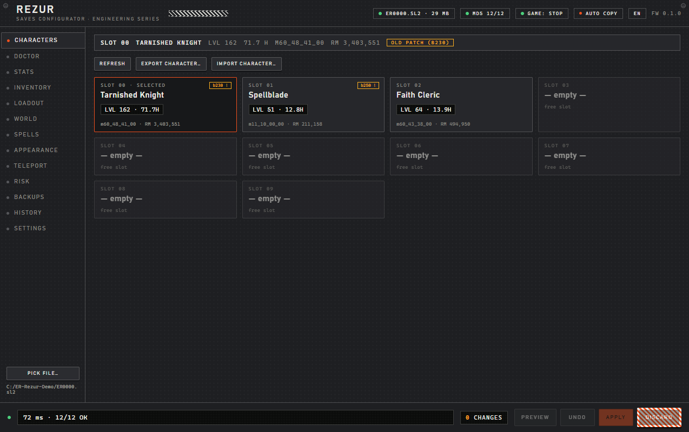
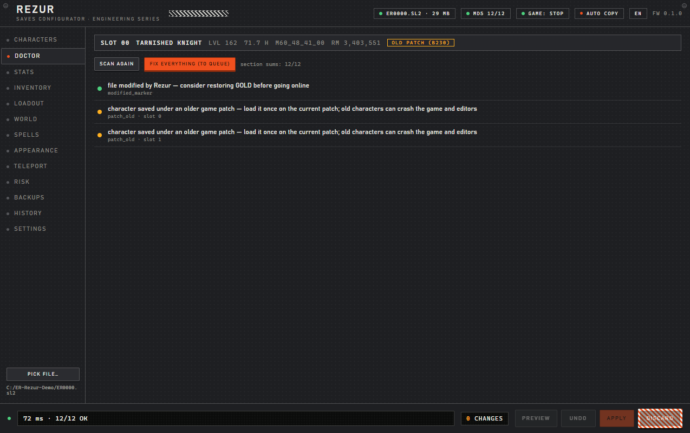
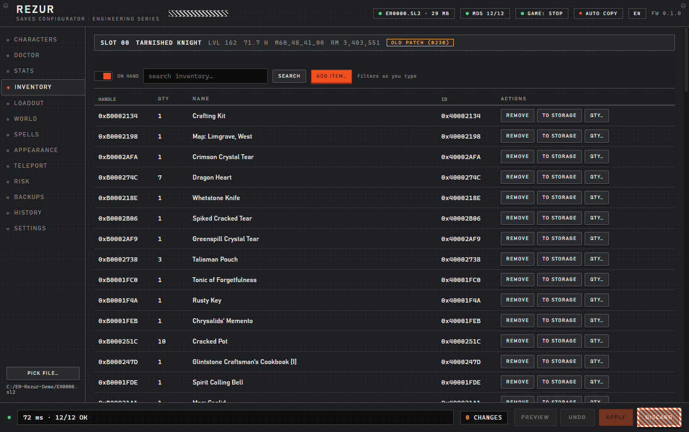
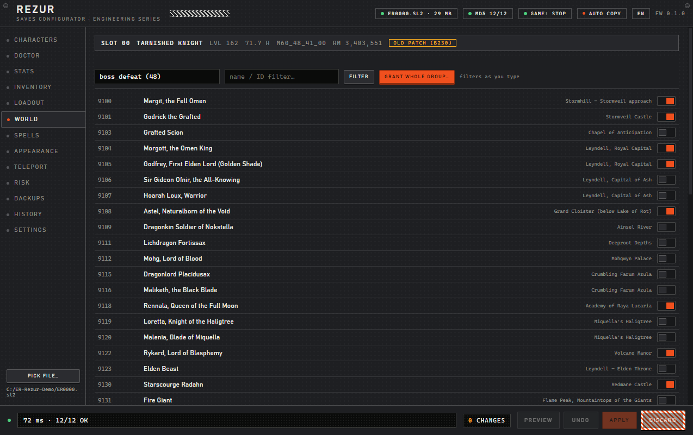
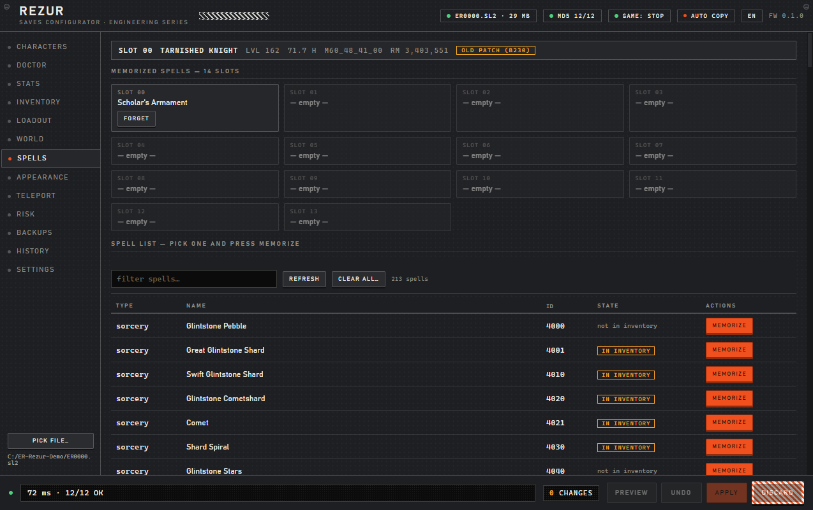
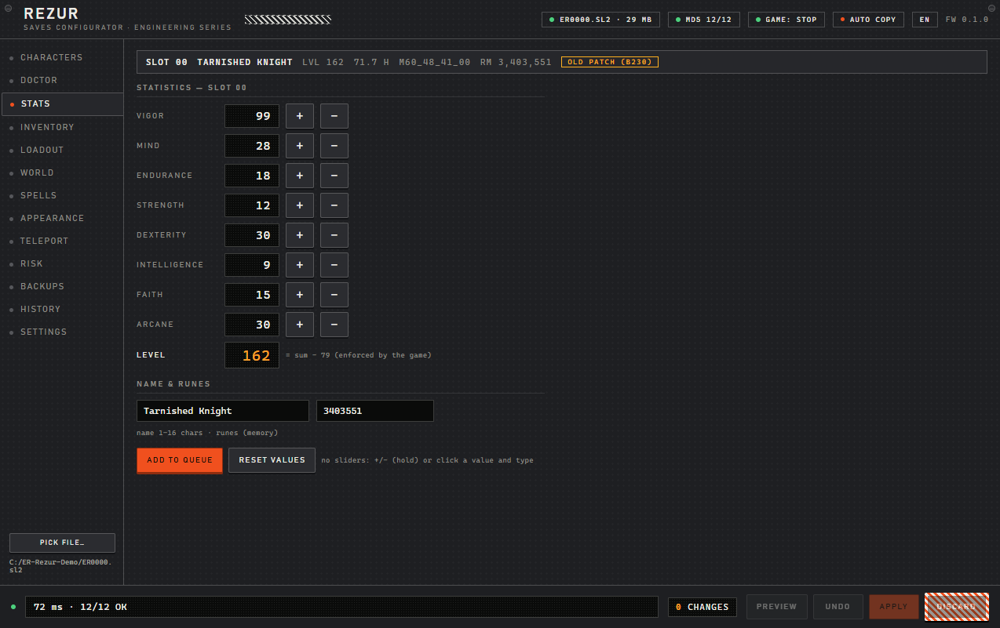
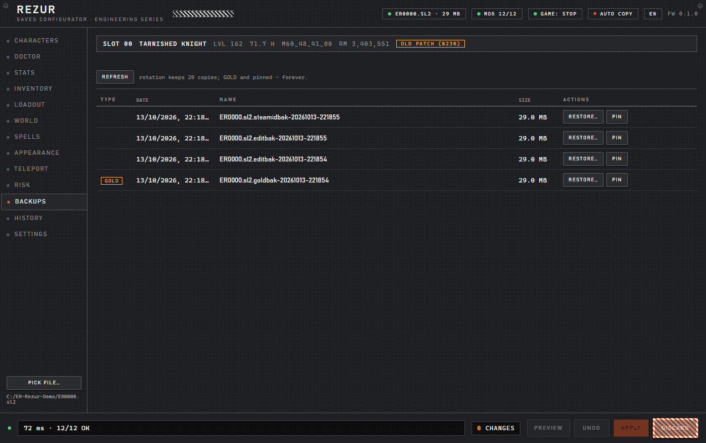
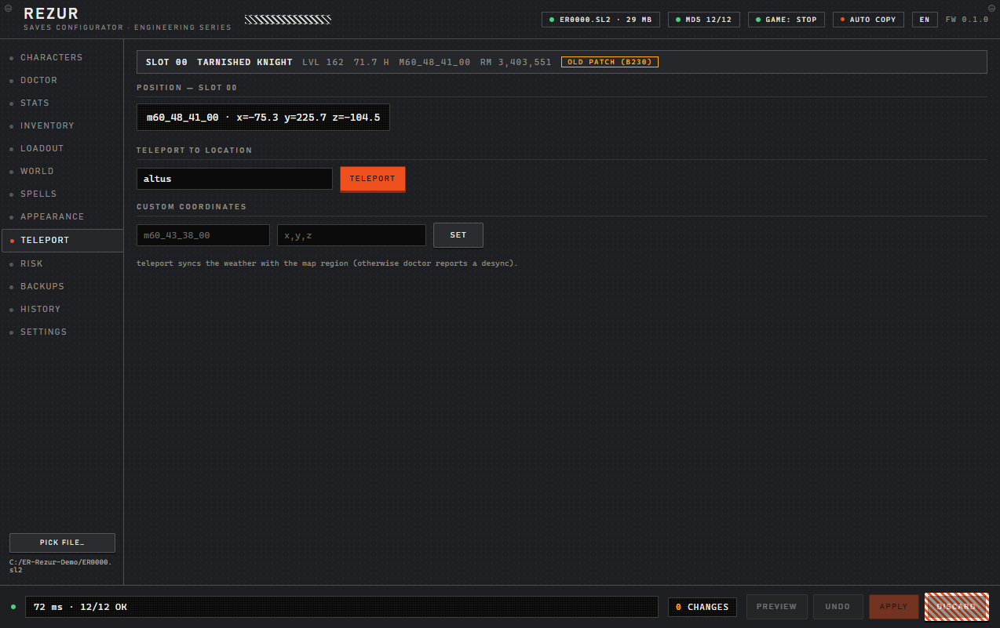

# Rezur Saves Configurator

Unofficial **Elden Ring** (PC / Steam, `ER0000.sl2`) save configurator and repair tool, built on a
format implementation verified byte-by-byte against real saves (v250–261, 1.16-era):

- **diagnostics + repairs** — section checksums, player hash, profile summary, weather/region
  desync, DLC fields, inventory counters, and the infamous **Torrent hang** (`hp=0` while
  `state=ACTIVE`, the classic Alt+F4 / crash bug)
- **editing** — stats / runes / name, items (add, remove, quantity, move, weapon upgrade, affinity,
  Ash of War), the full 22-slot loadout, spells (14 memory slots), appearance, teleport, and
  ~4 200 named world flags (bosses, maps, cookbooks, colosseums, summoning pools, invasion regions)
- **file safety** — one GOLD copy per file, tagged backups with rotation, pinned backups, atomic
  write with candidate verification **before** the original is replaced, staging-first edits, and
  an edit journal that powers an honest "this file was modified" marker
- **CLI + GUI** — ~34 subcommands and a native pywebview / WebView2 window (13 panels); both are
  thin adapters over the same engine

Everything runs **100% offline** — no network calls, no telemetry. The save file never leaves the machine.

## Download — one file, no Python

Grab the ZIP from the [latest release](https://github.com/Rezurmas/rezur/releases/latest), then:

1. unpack it anywhere (e.g. `C:\Rezur`),
2. double-click **`START-REZUR.cmd`** → the configurator window opens.

`rezur.exe` is a single self-contained file that holds **both the GUI and the CLI**:

```cmd
rezur.exe gui                      :: the window (same as the launcher)
rezur.exe info                     :: CLI: characters + container state
rezur.exe doctor                   :: CLI: diagnostics
rezur.exe fix --apply              :: CLI: repair everything (auto-backup first)
rezur.exe --help                   :: all subcommands
```

It finds your save automatically (newest `%APPDATA%\EldenRing\*\ER0000.sl2`); for a specific file use
`rezur.exe gui --save "C:\path\ER0000.sl2"`. Windows SmartScreen may warn once — the exe is
unsigned: *More info → Run anyway*. Needs Windows 10/11 64-bit with the WebView2 runtime
(preinstalled on both). `HOW-TO-RUN.txt` inside the ZIP repeats this in English and Polish.



| Doctor — diagnostics with one-click repairs | Inventory — live filter, staged edits |
|---|---|
|  |  |

| World — ~4 200 named flags with locations | Spells — full catalogue to pick from |
|---|---|
|  |  |

| Stats — no sliders: hold `+`/`−` or type a value | Backups — GOLD, pins, rotation |
|---|---|
|  |  |

<p align="center"></p>

## Quick start

```bash
git clone https://github.com/Rezurmas/rezur.git
cd rezur

python -m rezur info                      # characters + container state
python -m rezur doctor                    # diagnostics (read-only)
python -m rezur fix                       # what can be repaired (dry-run)
python -m rezur fix --apply               # repair everything (auto-backup first)
python -m rezur fix --only torrent --apply

python -m rezur stats --slot 0            # stats / runes / name (dry-run)
python -m rezur stats --slot 0 --set vigor=60,mind=40 --runes 5000000 --apply
python -m rezur item --find uchigatana    # search the item database
python -m rezur item --slot 0 --add "Uchigatana" --upgrade 5 --apply
python -m rezur item --slot 0 --remove "Uchigatana"
python -m rezur item --slot 0 --set-qty "Larval Tear=12"
python -m rezur item --slot 0 --move "Larval Tear" --to storage
python -m rezur inventory --slot 0        # held items (--storage = chest)
python -m rezur equipment --slot 0        # full 22-slot loadout
python -m rezur equip --slot 0 --item "Uchigatana" --at 0 --apply
python -m rezur unequip --slot 0 --at 0 --apply
python -m rezur item --slot 0 --set-upgrade "Uchigatana=10" --apply
python -m rezur item --slot 0 --affinity "Uchigatana=Blood" --apply
python -m rezur item --slot 0 --aow "Uchigatana=Bloody Slash" --apply
python -m rezur spells --slot 0                          # 14 memory slots
python -m rezur spells --slot 0 --list --filter heal     # spell catalogue + state
python -m rezur appearance --slot 0                      # gender / body type / gift
python -m rezur teleport --slot 0 --to roundtable --apply
python -m rezur world --groups                           # 25 named flag groups
python -m rezur world --slot 0 --group boss_defeat --filter Godrick
python -m rezur world --slot 0 --group boss_defeat --set "Godrick" --state 1 --apply
python -m rezur unlock --slot 0 --what maps --apply      # bulk unlocks
python -m rezur flags --slot 0 --get 600003
python -m rezur flags --slot 0 --set 600003:1 --apply
python -m rezur graces --list                            # grace regions
python -m rezur graces --slot 0 [--region "Limgrave"] --apply

python -m rezur copy --from 2 --to 3 --apply [--clear-source]
python -m rezur swap --a 1 --b 2 --apply                 # swap two characters
python -m rezur clear --slot 3 --apply                   # wipe a slot
python -m rezur export --slot 0 --out character.json
python -m rezur import --to 3 --in character.json --apply
python -m rezur steamid --set 7656119xxxxxxxxxx [--apply]
python -m rezur backups                                  # backups next to the save (GOLD/PIN markers)
python -m rezur backups --gold                           # undeletable GOLD copy (once per file)
python -m rezur backups --pin NAME                       # pin a backup (rotation skips it)
python -m rezur backups --restore NAME [--apply]
python -m rezur watch [--interval 600]                   # auto-backups: game start + interval
python -m rezur watch --once                             # one check
python -m rezur risk [--slot N] [--json]                 # online-risk scan + return path to GOLD
python -m rezur stage stats --slot 0 --set vigor=61      # edit the work copy (zero risk)
python -m rezur stage stats --save FILE --slot 0 --set vigor=61   # same, explicit save file
python -m rezur pending [--diff] [--undo]                # pending changes: count, diff, undo last
python -m rezur apply                                    # commit: 1 backup + 1 write + journal entry
python -m rezur discard                                  # drop the draft, original untouched
python -m rezur log [--json]                             # edit history
python -m rezur find "uchi" [--json]                     # items, world flags, graces, locations
python -m rezur gui [--save FILE]                        # native window (pywebview / WebView2)
python -m rezur gui --selftest                           # headless smoke test of the window
python -m rezur config                                   # retention / guard_live / ui_lang / …
python -m rezur list-fixes                               # registered repairs

# audits (outside the CLI):
python tests/run_all.py         # 48 tests on copies of real saves (cross-checked vs a reference parser)
python tests/smoke_cli.py       # every CLI command (135 invocations) on a save copy
python tests/bridge_audit.py    # GUI bridge: every API call (51) on a save copy, isolated config
```

Without `--save` the tool picks the newest save from `%APPDATA%\EldenRing\*\ER0000.sl2`.

## GUI

`python -m rezur gui` opens a WebView2 window (pywebview + pythonnet — works on Python 3.14).
Thirteen panels — **characters · doctor · stats · inventory · loadout · world · spells ·
appearance · teleport · risk · backups · history · settings** — plus a change bar at the bottom
(`PREVIEW / UNDO / APPLY / DISCARD`). The style is deliberate: engineering-series hardware
(black anodized body, a single orange accent, dot-matrix LCDs, no glows, **no sliders**).

- every edit goes through a **work copy** (staging); read panels show the staged draft, so you
  see the result before anything touches the original
- **language: English by default**, Polish optional — `EN/PL` pill in the header or the SETTINGS
  panel; the choice is stored as `ui_lang` in the config and the window reloads itself
- **live search** — inventory and world lists filter as you type; item / spell / equip fields show
  suggestions with the matched fragment highlighted (click, `Enter`, or `↑`/`↓`)
- **spell catalogue** — all 213 sorceries and incantations with a live filter and
  "in inventory / memorized" badges; `MEMORIZE` stages the change
- writes are blocked while `eldenring.exe` is running (`guard_live`), and the GUI says so in a banner

## Safety model

- every write goes through `SaveFile.write()`: **GOLD** (once per file) → tagged backup with
  rotation → `.tmp-rezur` + fsync → verification of the candidate (BND4 + every section MD5) →
  `os.replace`; a bad candidate aborts with the original untouched and no temp file left behind
- **GOLD** and **pinned** backups are never removed by rotation
- the CLI is dry-run by default; `--apply` is required to write anything
- `rezur watch` copies on game start and every `watch_interval` seconds; a copy taken mid-write
  fails verification and is dropped instead of preserving a torn state
- a truncated save (torn write) is rejected at load with an explicit message and a restore command
- every successful modification appends to `<save>.rezur-journal.json`; `rezur risk` shows the
  "modified by Rezur" marker and the exact command to return to GOLD
- repairs are re-verified by a fresh diagnostic pass; `doctor` also flags characters saved under an
  older game patch (`patch_old`)

## Verification

```bash
python tests/run_all.py         # 49 tests
python tests/smoke_cli.py       # 135 CLI invocations
python tests/bridge_audit.py    # 51 GUI-bridge calls
python -m rezur gui --selftest  # opens the real window: bridge, panels, live search, language switch
python tests/exe_e2e.py         # the packaged dist/rezur.exe: every CLI command + write flow, on save copies
python tests/gui_panels_check.py  # the live window: all 13 panels, staged edit + DISCARD, EN/PL, live search
```

The GUI selftest prints, from a live WebView2 window:

```
[selftest] booted=True characters_loaded=3 title='REZUR — Saves Configurator'
[selftest] bridge_methods=34 panels=13 lang='EN'
[selftest] live-search INVENTORY: rows_before=100 rows_after_typing_seed=3
[selftest] suggestions('mimi'): hits=14 first="Mimic's Veil"
[selftest] SPELLS list: rows=213 after_typing_heal=7 first='Heal'
[selftest] switch→pl: pill=ok tabs=POSTACIE|DOKTOR|STATY|…
[selftest] switch→en: pill=ok tabs=CHARACTERS|…
```

## Project layout

```
rezur/
  core/        format: bnd4 container, slots, checksums (MD5 + PlayerDataHash), profiles,
               SaveFile, vault (GOLD / pins / rotation), journal (edit log → "modified" marker)
  risk.py      online-risk scan: impossible data (stats, upgrades, quantities) + GOLD path
  staging.py   pending changes: work copy + manifest + per-op snapshots (stage/pending/apply/undo)
  games/       game registry (Elden Ring for now; structure ready for more)
  diag/        diagnostics engine (checks → Finding with a code and a linked fix)
  fixes/       repairs: torrent, checksums, playerhash, summary, weather, dlc, invcounters
  ops/         stats, items, loadout, spells, appearance, teleport, world flags, bulk grants,
               slot copy / swap / clear, SteamID, JSON transfer, backups, watch
  report/      text and JSON output
  gui/         pywebview window: api.py (JS↔engine bridge), app.py (shell + selftest), web/ (i18n EN/PL)
  cli.py       python -m rezur
  data/db_er/  item, flag, spell and grace tables
tests/         run_all.py · smoke_cli.py · bridge_audit.py
docs/screenshots/
tools/         fix_torrent, copy_slot, build_exe.cmd, sanitize_public.py, gh_login.sh
packaging/     PyInstaller spec (one-file .exe)
```

Technical details of the save format and the verified pitfalls: see `ARCHITECTURE.md`.

## Packaging (.exe)

```cmd
python -m pip install pyinstaller
tools\build_exe.cmd          :: or: python -m PyInstaller --clean --noconfirm packaging\rezur.spec
::   → dist\rezur.exe (single file, no installer; data tables bundled; GUI + CLI inside)

python tools\make_release_zip.py
::   → dist\Rezur-vX.Y.Z-win64.zip  (rezur.exe + START-REZUR.cmd + HOW-TO-RUN.txt)
::     ready to attach to a GitHub release
```

## Data sources

Item, flag, spell and grace tables were derived from the game's own data and from public community
projects — **ER-Save-Editor**, **EldenRing-SaveForge**, **ER-Save-Lib**, **er-save-manager**,
**sl2-analyzer** — and cross-checked against real saves (1.16-era). Rezur contains no code from
those projects, only its own format implementation and its own data files.

Game names, text and content belong to **FromSoftware / Bandai Namco**. This is an unofficial hobby
tool for your own save files.
